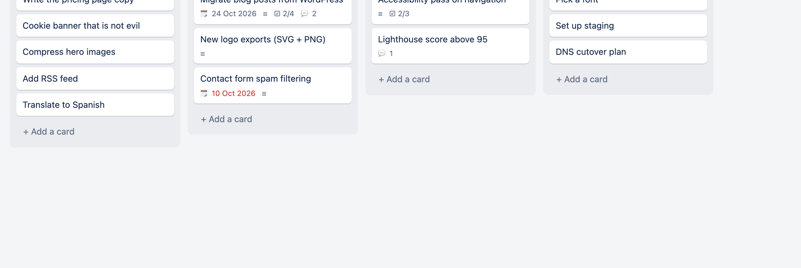
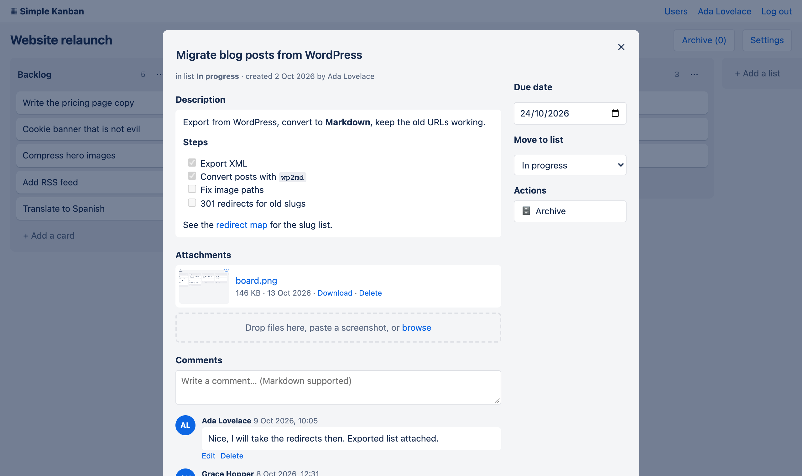
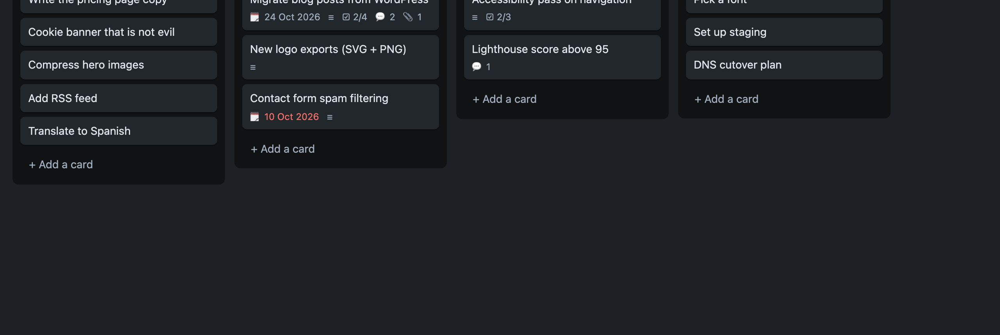

# simple-kanban

**A deliberately boring kanban board.** Next.js, one SQLite file, and a folder of uploads.
It comes with a one-command importer for people who are done with WeKan.



[](https://hub.docker.com/r/roura/simple-kanban)
[](LICENSE)

## Why

I ran WeKan for years. Every upgrade moved buttons around, the people I shared boards with
kept asking where things had gone, and one day the latest image simply wouldn't start.
All we ever used were boards, lists, cards, descriptions, comments and attachments.

simple-kanban does just those things, and the UI isn't going to be redesigned under you.

## Features

- **Boards → lists → cards**, with drag and drop for both cards and lists
- **Markdown descriptions**: `- [ ]` task lists show up as a ☑ 2/4 badge on the card
- **Comments**: Markdown, editable, deletable
- **Attachments**: drag files in, paste a screenshot, or browse. Images get thumbnails.
- **Due dates** (overdue ones turn red) and **archiving** that you can undo
- **Users and logins**: admins see every board, members see the boards they've been added to
- **Light and dark mode**, follows your system setting
- **One SQLite file**: back it up with `cp`. No Mongo, no Redis, no message queue.
- **WeKan importer**: brings over boards, cards, checklists, comments and attachments, and
  users keep their WeKan passwords

| Card details | Dark mode |
|---|---|
|  |  |

## Quick start

```bash
docker run -d --name simple-kanban -p 3000:3000 -v $PWD/data:/data roura/simple-kanban
```

Open <http://localhost:3000>. The first visit asks you to create the admin account.

Or with Compose ([docker-compose.yml](docker-compose.yml)):

```bash
curl -O https://raw.githubusercontent.com/rouralberto/simple-kanban/master/docker-compose.yml
docker compose up -d
```

Images are published for `linux/amd64` and `linux/arm64`.

### Configuration

| Env var         | Default  | Meaning                                                   |
|-----------------|----------|-----------------------------------------------------------|
| `DATA_DIR`      | `/data` in Docker, `./data` otherwise | Where `kanban.db` and `uploads/` live. |
| `PORT`          | `3000`   | HTTP port.                                                |
| `COOKIE_SECURE` | `false`  | Set to `true` when you serve it over HTTPS.               |
| `MAX_UPLOAD_MB` | `50`     | Largest file you can upload.                              |

**Backups:** copy the data folder, or take a consistent snapshot while it's running:
`sqlite3 data/kanban.db ".backup backup.db"` (and copy `uploads/`).

## Migrating from WeKan

The importer only reads from WeKan and never changes it. You can run it again safely: it keeps
WeKan's ids and skips anything that's already been imported. Start with `--dry-run` to see
what it would do.

**WeKan's MongoDB runs in Docker** (the usual setup):

```bash
git clone https://github.com/rouralberto/simple-kanban.git && cd simple-kanban
./migrate-from-wekan.sh --mongo-container <wekan-mongo-container-name>
```

The script reaches Mongo through a short-lived `alpine/socat` container on the same Docker
network, so you don't have to publish port 27017. It removes that container when it's done.
Then start simple-kanban with `-v $PWD/data:/data` and log in with your WeKan username (or
email) and password.

**simple-kanban already runs in Docker on the same network as Mongo:**

```bash
docker exec simple-kanban node scripts/import-wekan.mjs --mongo mongodb://<mongo-host>:27017/wekan
```

**Mongo is reachable directly:**

```bash
./migrate-from-wekan.sh --mongo-url mongodb://localhost:27017/wekan
```

Useful flags:

- `--dry-run`: shows what would be imported and writes nothing.
- `--wekan-files <dir>`: the host folder mounted as WeKan's `/data`. You only need this if your
  attachments are stored on disk rather than in GridFS; the importer tells you if so.
- `--skip-archived`: leaves out archived boards, lists and cards.
- `--include-templates`: also imports WeKan's "Templates" board.

Each run writes a JSON report next to the database.

### What carries over

| WeKan                                     | simple-kanban                                                     |
|-------------------------------------------|-------------------------------------------------------------------|
| Users + passwords                         | Users. Passwords keep working; the hash is upgraded on first login. |
| Boards, active members                    | Boards, board members                                             |
| Lists                                     | Lists, in the same order                                          |
| Cards: title, description, due date, order, archived | Same                                                   |
| Checklists                                | Added to the description as Markdown task lists                   |
| Comments                                  | Comments, with their original author and timestamp                |
| Attachments (GridFS, filesystem, old CollectionFS) | Files in `data/uploads`                                  |
| Labels, members/assignees, received/start/end dates, parent card | One "Imported from WeKan" line at the end of the description |
| Swimlanes                                 | Flattened. If a board really uses several, its lists become "List · Swimlane". |
| Activities, rules, custom fields, linked cards, S3-stored files | Not imported (listed as warnings)            |

Users who logged in through OAuth or LDAP have no password in WeKan. An admin sets one from
**Users**, or with `create-user` (below).

## Admin tasks

```bash
# create a user, or reset an existing user's password
docker exec simple-kanban node scripts/create-user.mjs alice 'a-long-password' --admin
# without Docker
npm run create-user -- alice 'a-long-password' --admin
```

Admins see every board. Everyone else sees only the boards they're a member of, which is
managed on each board's **Settings** page.

## Development

```bash
npm ci --ignore-scripts   # better-sqlite3 ships prebuilt binaries; no compiler needed
npm run dev               # http://localhost:3000, data in ./data
```

The stack is Next.js (App Router and server actions), `better-sqlite3`, `bcryptjs` and
`react-markdown`, with no CSS framework. The schema is plain SQL in [`lib/db.js`](lib/db.js).

### Tests

```bash
npm run build && npm run test:smoke
```

This starts the production build against a temporary data folder and runs the whole UI in your
installed Chrome (`HEADED=1` lets you watch). It covers first-run setup, login, boards, lists,
cards, drag and drop, descriptions, comments, uploads and downloads, archiving, permissions, and
logging in with a WeKan password hash.

## License

[MIT](LICENSE) © [Alberto Roura](https://albertoroura.com)
